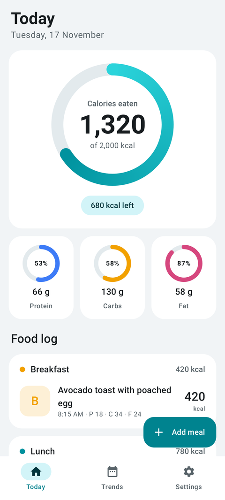
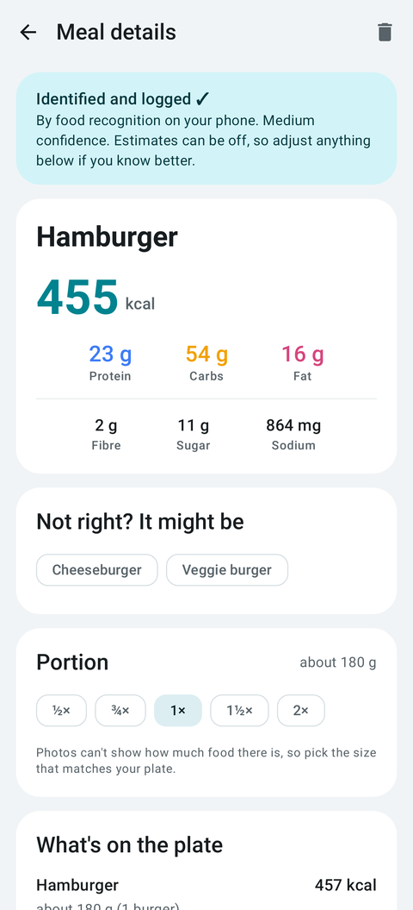
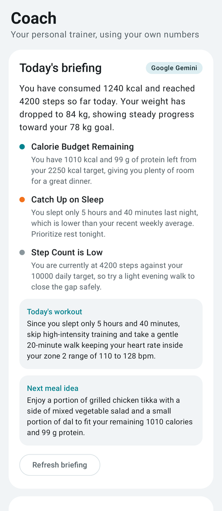

# MealSnap

A calorie tracker for Android (built for a Pixel 9 Pro) where logging a meal is just a photo.
Snap your plate before you eat. MealSnap works out what the dish is, how much of it there is and
how many calories it has, and logs all of it for you. **It works entirely on your phone with no account,
no API key, no subscription and no internet.** Add a free Google key if you want smarter results.

<p>
  
  
  
  
  
</p>

## How it works

1. Tap **Add meal** and choose **Take a photo** (opens the Pixel camera), **Upload a photo** (any picture
   already on the phone) or **Enter manually**.
2. The photo is recognised **on the phone**:
   - Google's food classifier (about 2,000 dishes, runs offline) names the dish.
   - A built-in nutrition table turns the dish and a typical serving into calories, protein, carbs, fat,
     fibre, sugar and sodium.
   - The most likely alternatives appear as chips ("Not right? It might be Cheeseburger"), and
     **portion chips** (½×, ¾×, 1×, 1½×, 2×) rescale everything, because a photo can't tell how much food there is.
3. The meal is **logged automatically** to Today, and you can open it any time to see the full breakdown
   or correct it.
4. **Today** shows a calorie ring against your goal, macro rings and a food log grouped by meal.
   **Trends** shows the last 7 days and every earlier day.

If a dish isn't recognised, type its name: matching foods from the table appear as you type, and
picking one fills in the calories, so you never have to look numbers up.

The look is inspired by the Fitbit app: teal activity rings, white rounded cards on a soft grey
canvas, a pill navigation bar, with light and dark themes.

## What it can and can't do (please read)

- Calories are **estimates**: a typical serving of the recognised dish. Adjust the portion chips to match
  your plate. Mixed plates with several dishes are reduced to the single most likely dish unless your phone
  supports the optional Gemini Nano mode below.
- The food model knows about 2,000 dishes but not everything. For example it has no plain *dosa*, *naan* or
  *roti* label; for those, type the name and pick it from the list. The table has about 230 common foods,
  including many Indian, Asian, Middle Eastern and Western dishes. Anything outside it gets a generic plate
  marked "low confidence".
- Recognition quality depends on the photo: good light, the dish filling the frame, top-down or
  slightly angled.

## Personal trainer (Coach tab)

Tell MealSnap your height, weight, year of birth, activity level and goal, and the **Coach** tab works out safe
targets and coaches you using your own meals, heart rate, sleep and weight.

- **Your numbers:** BMI, resting burn (Mifflin-St Jeor), daily burn with your activity, a suggested calorie intake
  for your goal, protein/carb/fat targets, water, steps and heart-rate zones. The app never suggests eating
  below 1,200 kcal (women), 1,500 kcal (men) or 1,350 kcal (other), and suggests no deficit if your BMI is
  underweight. One tap makes the suggestion your daily goal.
- **Health data from your tracker:** steps, heart rate, resting heart rate, sleep, active and total calories,
  distance, workouts, weight, heart-rate variability and blood oxygen are read from Android's **Health Connect**,
  with your permission and read-only. Everything stays on your phone.
- **Tips with no AI at all:** rule-based tips from your numbers (resting heart rate jumping above your average,
  a short night, too little protein, eating far too little, steps, weight changing too fast...), always with
  "see a doctor" advice when a reading is outside a normal range.
- **AI trainer (optional, needs a free Google key):** a daily briefing with a workout and a next-meal idea,
  and a chat where you can ask anything ("should I train on 5 hours' sleep?"). It sees a text summary of your
  numbers, never your photos or name, and only after you agree (switchable any time in Settings).
- **Weight log:** type a weigh-in (or let a smart scale write it to Health Connect) and see your trend and
  distance to target.

### Connecting a Fitbit Air

The old Fitbit cloud API was switched off in 2026 and its replacement (the Google Health API) needs Google's
approval for each app, so MealSnap does not use it. Instead it reads what the **Google Health** app (the new
Fitbit app) shares with **Health Connect** on your phone:

1. Pair the Fitbit Air in the Google Health app.
2. In that app, turn on sharing with Health Connect (look for Health Connect in its settings).
3. In MealSnap's Coach tab, tap **Allow health data** and choose what it may read.
4. Tap **Check what's arriving**: it lists how many records of each kind arrived in the last 7 days and which app
   wrote them, so you can see exactly what your band is sharing.

I could not test this with a real Fitbit Air. How much of its data Google Health writes to Health Connect is
decided by Google and may change, which is what the data check is for.

## Optional extras (never required)

- **Google Gemini (free key, recommended upgrade):** add a free key from
  [Google AI Studio](https://aistudio.google.com/apikey) in Settings and photos are read by Gemini, which names
  **every item on the plate** and estimates each portion and its calories, instead of the single most likely dish.
  Setup is three steps in Settings: open AI Studio, paste the key, Save (the app tests it).
  - Free keys have daily limits. When the quota runs out, or there is no internet, MealSnap quietly uses
    on-device recognition instead and says so in the meal's notes.
  - Google's model names and capacity change often, so the app picks a fast, stable model (Flash-Lite by default)
    and automatically tries others if one is retired, busy or silent.
- **Gemini Nano (Pixel AI):** if your phone supports it, Settings shows a one-time download. It can read a
  whole plate on the device. It is checked at run time and silently skipped if the phone doesn't support it.
- **Claude:** if you already have an Anthropic API key you can add it in Settings too (about 1 to 2 US cents per
  photo, billed by Anthropic). If both a Google and an Anthropic key are set, Google is tried first.

## Install on your Pixel

1. Get the APK: download **MealSnap-apk** from the latest run on the repo's *Actions* tab
   (unzip it to get `app-release.apk`), or build it yourself (below).
2. Open the APK on the phone. Android will ask to allow installs from that app (Chrome, Files, …):
   allow it once, then tap **Install**. Play Protect may say the app is unrecognised because it
   isn't from the Play Store; choose **Install anyway**.

Every build is signed with the same key, so a newer APK installs over the old one and keeps your meals.

## Privacy

Photos and the meal log are stored only on the phone (app-private storage), and by default recognition
happens on the phone. A photo leaves the device only if you add a Google or Anthropic key, in which case it is
sent to that company for analysis. **On Google's free tier, Google may use what you send to improve its
products**, so don't use a Google key for photos or health data you want to keep private. The personal trainer sends
a text summary of your profile and health numbers to Google only when you ask for a briefing or chat, and only if
you agreed in the app; health data is read from Health Connect and never leaves the phone otherwise. Keys you add are stored in the app's
private settings and excluded from Android backups. Remove a key in Settings to go back to fully on-device.

## Build it yourself

Requires JDK 17+ and the Android SDK (platform 36, build-tools 36).

```bash
echo "sdk.dir=$ANDROID_HOME" > local.properties
./gradlew :app:testDebugUnitTest      # unit tests + screenshot tests (app/build/screenshots)
./gradlew :app:assembleRelease        # app/build/outputs/apk/release/app-release.apk
```

## Under the hood

| Part | Choice |
|------|--------|
| UI | Kotlin, Jetpack Compose, Material 3 with a custom Fitbit-inspired theme |
| Camera / upload | System camera (`TakePicture`, no camera permission needed) and the Android photo picker |
| Recognition | Bundled AIY food classifier (TFLite, 192 px, quantised) run with LiteRT; optional Google Gemini over REST (model list, fallback chain, JSON mode); optional Gemini Nano via the ML Kit GenAI Prompt API; optional Claude via the Anthropic Java SDK |
| Nutrition | Built-in table of about 230 foods per 100 g plus typical servings; every row is unit-tested for calorie/macro consistency |
| Health | Health Connect client (read-only): steps, heart rate, sleep, calories, weight, HRV, SpO2 |
| Storage | Room (meals and weights, with tested migrations), private files (photos), DataStore (settings) |
| Tests | Parsing, matching, request shape, day maths, DB schema; Gemini parsing and model ranking tested against captured real API responses; Robolectric screenshot tests render every screen |
| Min Android | 12 (API 31), arm64 devices, targets API 36 |

See [NOTICE.md](NOTICE.md) for third-party licences. `app/debug.keystore` is the standard public Android
debug key, committed on purpose so that every build (local or CI) is signed identically. This is a
sideloaded personal app; it is not set up for Play Store release.

## License

MIT, see [LICENSE](LICENSE). Bundled third-party components keep their own licences, listed in [NOTICE.md](NOTICE.md).
