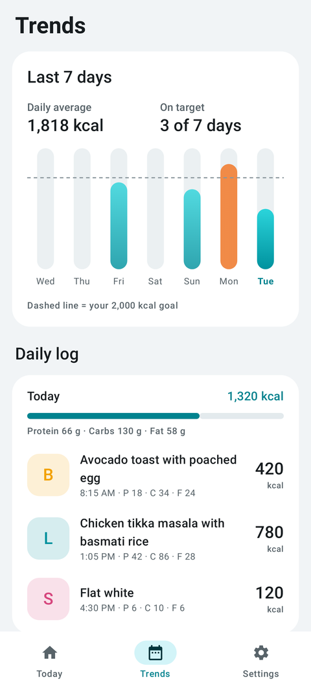
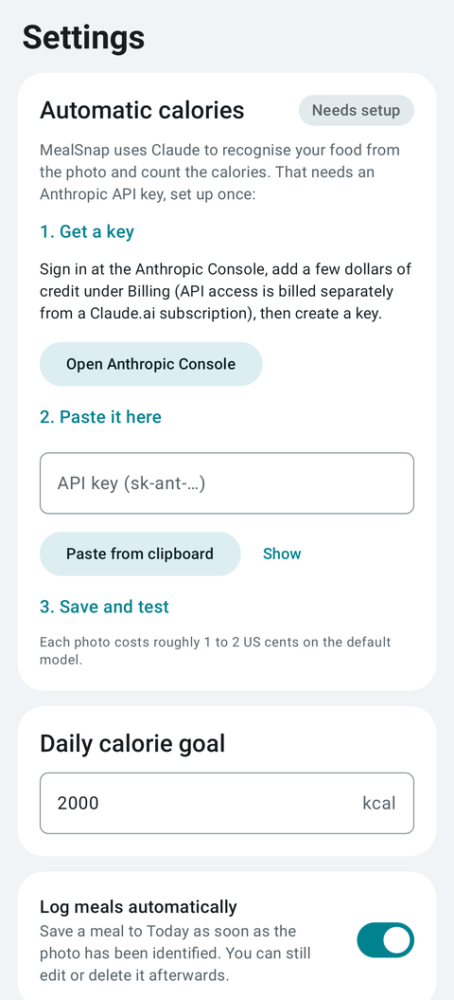

# MealSnap

A calorie tracker for Android (built for a Pixel 9 Pro) where logging a meal is just a photo.
Snap your plate before you eat. MealSnap works out what the dish is, how much of it there is and
how many calories it has, and logs all of it for you. No typing.

<p>
  
  
  
  
</p>

## How it works

1. Tap **Add meal** on the Today screen and choose **Take a photo** (opens the Pixel camera) or
   **Upload a photo** (pick any picture already on the phone). **Enter manually** is there too.
2. The photo goes to Claude, which identifies the dish and returns:
   - the **dish name** and cuisine,
   - every **ingredient/item** with an estimated **portion**, calories and protein/carbs/fat,
   - totals including **fibre, sugar and sodium**,
   - the **visual cues** it used (plate size, cutlery for scale, sauce, …) and a confidence level.
3. The meal is **logged automatically** to Today. Open it any time to see the full breakdown, correct
   anything, or tell the AI what it missed ("half portion, oat milk") and re-estimate.
4. **Today** shows a calorie ring against your goal, macro rings and a food log grouped by meal.
   **Trends** shows the last 7 days and every earlier day.

The look is inspired by the Fitbit app: teal activity rings, white rounded cards on a soft grey
canvas, a pill navigation bar, with light and dark themes.

## Set up automatic calories (once, about a minute)

Recognising food from a photo needs an AI model, so MealSnap uses your own Anthropic API key.
Until a key is added, photos can't be analysed and you'd have to type calories in by hand, so the app
asks you to set it up the first time you add a photo.

1. In **Settings**, tap **Open Anthropic Console**, sign in, add a few dollars of credit under
   Billing (API access is billed separately from a Claude.ai subscription) and create a key.
2. Copy the key, return to MealSnap and tap **Paste from clipboard**.
3. Tap **Save and test**. It confirms the key works before you rely on it.

## Install on your Pixel

1. Get the APK: download **MealSnap-apk** from the latest run on the repo's *Actions* tab
   (unzip it to get `app-release.apk`), or build it yourself (below).
2. Open the APK on the phone. Android will ask to allow installs from that app (Chrome, Files, …):
   allow it once, then tap **Install**. Play Protect may say the app is unrecognised because it
   isn't from the Play Store; choose **Install anyway**.

Every build is signed with the same key, so a newer APK installs over the old one and keeps your meals.

## Cost and privacy

- Each photo is one Claude API request (a downscaled ~1568 px JPEG plus a short prompt), roughly a cent
  or two on the default model. Settings lets you switch to Sonnet or Haiku to make it cheaper.
- Photos and the meal log are stored only on the phone (app-private storage). A photo leaves the
  phone only when it is sent to Anthropic for analysis. Your API key is stored in the app's private
  settings and excluded from Android backups.
- Calorie numbers from a photo are estimates. Treat them as a guide, not a measurement.

## Build it yourself

Requires JDK 17+ and the Android SDK (platform 36, build-tools 36).

```bash
echo "sdk.dir=$ANDROID_HOME" > local.properties
./gradlew :app:testDebugUnitTest      # unit tests + screenshot tests (app/build/screenshots)
./gradlew :app:assembleRelease        # app/build/outputs/apk/release/app-release.apk
```

## Under the hood

| Part | Choice |
|------|--------|
| UI | Kotlin, Jetpack Compose, Material 3 with a custom Fitbit-inspired theme |
| Camera / upload | System camera (`TakePicture`, no camera permission needed) and the Android photo picker |
| Storage | Room (meals, with a tested 1 to 2 migration), private files (photos), DataStore (settings) |
| AI | Official Anthropic Java SDK, structured JSON output, default model `claude-opus-5-5` at low effort, with server-side refusal fallback enabled |
| Tests | Unit tests for parsing, request shape, day maths and the DB schema; Robolectric screenshot tests render every screen |
| Min Android | 12 (API 31), targets API 36 |

`app/debug.keystore` is the standard public Android debug key, committed on purpose so that every
build (local or CI) is signed identically. This is a sideloaded personal app; it is not set up for Play Store release.
